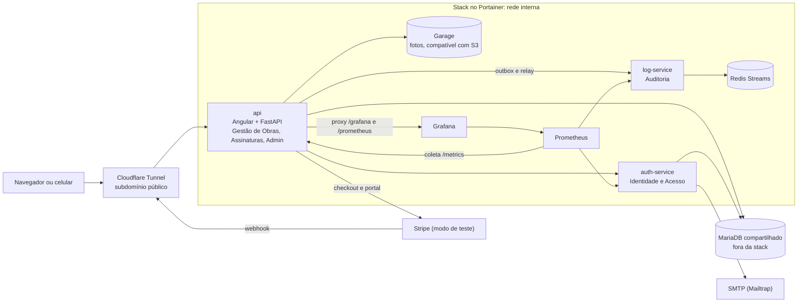

# Nivelo

**Diário de obra no celular para pequenos empreiteiros: registre o dia em 2 minutos e mostre ao cliente, com foto e data, tudo o que foi feito.**

> Projeto da disciplina ISW055 — professor [github.com/siriani](https://github.com/siriani).
> Continuação do projeto HANK+, feito com espelhamento do repositório e todo o histórico de commits.

**No ar:** <https://marcio-mazega-isw055.lapps.studio> · API documentada em [`/api/docs`](https://marcio-mazega-isw055.lapps.studio/api/docs). A cobrança está em modo de teste do Stripe.

---

## 1. A dor

**Quem sofre:** o empreiteiro ou a pequena construtora com 2 a 10 obras residenciais ao mesmo tempo (reformas, casas, ampliações), sem engenheiro dedicado nem software de gestão.

**Quando:** no fim de cada etapa e, principalmente, no fim da obra, na hora de receber. É nesse momento que o cliente questiona o atraso ("ficou 3 semanas parado"), o material ("comprei 40 sacos de cimento, cadê?") ou o serviço ("isso não estava no combinado").

**Quanto custa hoje:**

- **Dinheiro:** a última parcela (10% a 20% do contrato) fica retida por semanas enquanto se discute. Numa reforma de R$ 60 mil, são R$ 6 mil a R$ 12 mil parados ou perdidos num desconto "pra encerrar a briga".
- **Tempo:** 3 a 5 horas por semana mandando foto no WhatsApp, explicando por áudio e procurando o print de dois meses atrás.
- **Risco:** sem registro de chuva, falta de material ou mudança pedida pelo cliente, o atraso vira culpa do empreiteiro, e o próximo cliente chega pela indicação de alguém insatisfeito.

**Como resolve hoje:** fotos soltas no WhatsApp, caderno no canteiro, planilha que ninguém atualiza ou simplesmente memória.

## 2. Persona

**Valdir Rocha, 47 anos, empreiteiro em Marília/SP.**

- Toca 4 obras ao mesmo tempo com 7 funcionários; dois deles são encarregados que ficam no canteiro.
- Passa o dia entre as obras de caminhonete, resolve tudo pelo celular e não abre computador.
- **O que tenta fazer:** entregar no prazo, receber a última parcela sem discussão e ganhar o próximo cliente por indicação.
- **O que atrapalha:** o cliente liga perguntando "como está a obra?" duas vezes por dia; quando dá atraso por chuva ou por falta do material que o próprio cliente ia comprar, ele não tem como provar. Na última obra, deu R$ 4 mil de desconto para não brigar.
- **Frase dele:** "Eu tenho foto de tudo, o problema é achar."

## 3. Concorrentes e alternativas

| Alternativa | O que faz | O que faz mal para o Valdir |
|---|---|---|
| **Grupo de WhatsApp com o cliente** | Fotos e áudios na hora, de graça | Nada organizado por dia; some no histórico; não tem valor de prova nem relatório |
| **Caderno ou planilha** | Registro do dia no papel ou no Excel | Ninguém atualiza; o cliente não vê; não tem foto; perde-se ou molha |
| **Meu RDO** | RDO com fotos e PDF; Free com 1 obra ativa, Profissional a R$ 49,99/mês | Feito "para engenheiros e construtoras"; o cliente da obra não é usuário do produto |
| **Prumo** | Gestão de obras mobile-first; Free com 1 obra, Pro a R$ 67/mês (2 obras), Business a R$ 249/mês | Mistura RDO com despesas e papéis de engenharia; o Pro só cobre 2 obras |
| **Dia de Obra** | Pro a R$ 34/mês com obras e usuários ilimitados | Foco em gestão remota de equipe e equipamentos, não na prova para o cliente |
| **ObraFácil / ObraUp** | Plataformas completas (financeiro, compras, Last Planner), de R$ 79 a R$ 349/mês | Grandes e caras demais para quem toca 4 reformas |

## 4. Proposta de valor

**Para o empreiteiro que vive no celular, o Nivelo transforma as fotos que ele já tira em um diário de obra com data, clima e registro imutável, que o cliente acompanha por um link, sem planilha e sem curso.**

## 5. Modelo de receita com Stripe

Cobrança por **empresa** (o dono paga; encarregados e clientes não pagam), assinatura mensal no Stripe.

Estratégia: o Free mais completo da categoria, para virar hábito, e o Pro mais barato entre os planos pagos com obras ilimitadas.

| Plano | Preço | O que inclui | Limite |
|---|---|---|---|
| **Free** | R$ 0,00 | Diários ilimitados, fotos, ocorrências, histórico de auditoria, clientes acompanhando pelo app | **1 obra ativa**, 30 fotos por obra, 1 encarregado |
| **Pro** | R$ 29,90/mês | Obras ativas ilimitadas, fotos ilimitadas, até 5 pessoas na equipe | Sem limite de obras |
| **Construtora** | R$ 69,90/mês | Tudo do Pro, equipe ilimitada, logo da empresa no relatório | — |

Os clientes da obra nunca contam no limite e nunca pagam: cada cliente que acompanha uma obra é um canal de indicação.

**Por que alguém paga o Pro:** o Free deixa o Valdir provar o valor numa obra inteira, sem limite de diários. Na segunda obra simultânea, ele precisa do Pro. R$ 29,90 é menos de 0,5% da parcela que fica retida numa única discussão, e mais barato que qualquer concorrente pago com obras ilimitadas.

A assinatura pertence à **empresa** (o tenant). Quem assina é o usuário com papel `dono`; o customer e a subscription do Stripe ficam guardados na assinatura da empresa.

## 6. Métricas de sucesso

| Métrica | O que mostra | Meta inicial (3 meses) |
|---|---|---|
| Empresas cadastradas | Interesse | 50 |
| Ativação: empresas com 5+ diários na 1ª semana | O fluxo central funciona | 40% dos cadastros |
| Assinantes pagos (Pro + Construtora) | Disposição de pagar | 20 |
| **MRR** (receita recorrente mensal) | Saúde do negócio | R$ 700 |
| Conversão Free → Pro | O limite do Free está bem calibrado | 15% |
| Retenção mensal (churn) | O produto vira hábito | churn < 8% ao mês |
| Clientes finais que abrem o link | Valor percebido e canal de indicação | 70% das obras ativas |

## 7. Lean Canvas

| Bloco | Nivelo |
|---|---|
| **Problema** | 1) Empreiteiro não consegue provar o que fez, quando e por que atrasou. 2) Cliente sem visibilidade liga o tempo todo. 3) Registro espalhado no WhatsApp e no papel. *Hoje:* WhatsApp, caderno, planilha. |
| **Segmentos de clientes** | Empreiteiros e pequenas construtoras com 2 a 10 obras residenciais. *Primeiros adotantes:* empreiteiros da região de Marília/Tupã/Pompeia que já mandam foto da obra para o cliente pelo WhatsApp. |
| **Proposta única de valor** | Seu diário de obra em 2 minutos pelo celular, com prova que o cliente acompanha por um link. |
| **Solução** | 1) Diário do dia com fotos, clima automático e ocorrências. 2) Histórico imutável (quem registrou, quando, o que mudou). 3) Link do cliente e relatório RDO em PDF. |
| **Canais** | Indicação no próprio link do cliente ("feito com Nivelo"), lojas de material de construção da região, grupos de empreiteiros no WhatsApp/Facebook, Instagram com vídeos curtos de canteiro. |
| **Fontes de receita** | Assinatura mensal por empresa no Stripe: Free R$ 0, Pro R$ 29,90, Construtora R$ 69,90. |
| **Estrutura de custos** | VM Proxmox já existente (energia/link), domínio, armazenamento das fotos (Garage), e-mail transacional (Brevo), taxas do Stripe por cobrança, tempo de desenvolvimento e suporte. |
| **Métricas-chave** | Cadastros, ativação (diários na 1ª semana), assinantes Pro, MRR, churn, % de links do cliente abertos. |
| **Vantagem injusta** | Produto feito para quem não é engenheiro (simplicidade como decisão, não falta de recurso); contato direto com empreiteiros da região; o histórico de obras acumulado na conta, que fica caro de abandonar. |

## 8. Mapa de reaproveitamento

| Peça do HANK+ | O que vira no Nivelo |
|---|---|
| Catálogo (API externa) | Serviço `obras`: obras, diários do dia, fotos, ocorrências |
| Favoritos | Obras que o cliente acompanha (vínculo cliente ↔ obra) |
| Comentários | Comentários do cliente em cada diário |
| Microsserviço de login (auth-service, rede interna) | Login, cadastro da empresa, convite de encarregado e de cliente |
| RBAC no banco e nas APIs | Papéis `admin` (plataforma), `dono`, `encarregado`, `cliente`; os papéis temáticos antigos saem |
| Multi-tenancy (novo) | Toda consulta filtra por `empresa_id`, vindo do token, nunca da requisição |
| Esqueci minha senha + e-mail (Mailtrap/Brevo) | Mantido, mais convites, aviso de diário novo e resumo semanal ao cliente |
| Rate limiting por rota | Mantido; mais rígido no upload de fotos e no link público do cliente |
| Logs e auditoria (Redis Streams) | Eventos de negócio: "obra criada", "diário registrado", "diário editado", "foto enviada", "cliente visualizou", "assinatura alterada"; é o próprio valor de prova do produto |
| Upload e perfil (Garage) | Fotos do diário, logo da empresa, foto de perfil |
| Plano Premium (Stripe) | Assinatura Free/Pro por empresa, com checkout, webhooks e portal do cliente |
| Swagger / OpenAPI | API de obras e diários documentada |
| CI/CD (GitHub Actions → GHCR) | Mantido: build e deploy a cada push |
| Observabilidade (Prometheus/Grafana) | Mantida, mais métricas de negócio: diários por dia, assinantes, MRR |
| Portainer, MariaDB, Redis, Garage, subdomínio | Mesma stack e mesmo subdomínio; a troca para este repositório é a Atividade 10 |

## 9. Papéis e permissões

O usuário é um só (um e-mail, uma senha), e o papel de negócio vem do **vínculo** com cada empresa. A mesma pessoa pode ser encarregada numa construtora e cliente de outro empreiteiro. O token carrega a **empresa ativa** e o papel nela, e a troca de empresa emite um token novo.

| Ação | admin | dono | encarregado | cliente |
|---|---|---|---|---|
| Ver painel admin e log global | ✅ | ❌ | ❌ | ❌ |
| Criar, editar, remover obra | ❌ | ✅ | ❌ | ❌ |
| Adicionar ou remover membro da obra, convidar pessoas | ❌ | ✅ | ❌ | ❌ |
| Ver obras | ❌ | todas da empresa | as que é membro | as que é membro |
| Registrar, editar, publicar diário | ❌ | ✅ | nas suas obras | ❌ |
| Revisar diário publicado (com motivo) | ❌ | ✅ | só os próprios | ❌ |
| Remover diário | ❌ | só rascunho | ❌ | ❌ |
| Anexar ou remover foto | ❌ | ✅ | nas suas obras | ❌ |
| Comentar em diário publicado | ❌ | ✅ | ✅ | ✅ |
| Assinar ou gerenciar o plano | ❌ | ✅ | ❌ | ❌ |
| Ver o log da própria empresa | ❌ | ✅ | ❌ | ❌ |

Regras que valem para todas as linhas:

- **Quem decide é a API.** A tela esconder um botão é só conforto: ação proibida para o papel responde **403** e gera o evento de auditoria `acesso.negado`.
- **A empresa vem só do token.** Um recurso de outra empresa responde **404**, sem revelar que existe. Uma rede de segurança no banco faz qualquer consulta sem empresa definida falhar.
- **Quem ainda não tem empresa** (token sem tenant) só consegue criar a primeira empresa e listar os próprios vínculos; o resto responde 403.
- **O admin é da plataforma**, criado por variável de ambiente no primeiro boot, nunca pelo cadastro público. Ele não pertence a empresa nenhuma e não lê dados de obras.
- **O cadastro público** cria sempre a empresa e o seu dono; qualquer papel enviado no corpo é ignorado. Encarregados e clientes entram por **convite** do dono, com link de uso único que vale 72 horas.

Decisões e trade-offs: [ADR 004](docs/adr/004-tenancy-por-coluna-e-vinculos.md) (tenancy e vínculos) e [ADR 005](docs/adr/005-jwt-padrao-b-validade-2h.md) (token).

## 10. Arquitetura

Uma stack no Portainer, com uma única porta publicada, a do serviço `api`. Os demais serviços só existem na rede interna do Docker.

Decisões principais: [contextos](docs/adr/001-contextos-delimitados.md), [hexagonal](docs/adr/002-arquitetura-hexagonal.md), [outbox](docs/adr/003-outbox-para-eventos.md), [tenancy](docs/adr/004-tenancy-por-coluna-e-vinculos.md) e [lista completa dos ADRs](docs/adr/README.md).

## 11. Documentação

| Documento | Para quê |
|---|---|
| [`docs/DEPLOY.md`](docs/DEPLOY.md) | Deploy no Portainer, backup e caminho de volta |
| [`docs/STRIPE.md`](docs/STRIPE.md) | Configuração da assinatura, teste com cartões e diagnóstico de erros |
| [`docs/GLOSSARIO.md`](docs/GLOSSARIO.md) | Linguagem do domínio |
| [`db/README.md`](db/README.md) | Migrações e SQL exportado |
| [`docs/ENTREGA_ATIVIDADE_10.md`](docs/ENTREGA_ATIVIDADE_10.md) | Checklist da Atividade 10 |
| [`docs/ENTREGA_ATIVIDADE_11.md`](docs/ENTREGA_ATIVIDADE_11.md) | Checklist da Atividade 11 |

## 12. Backlog

As próximas entregas estão nas [issues](../../issues) deste repositório.